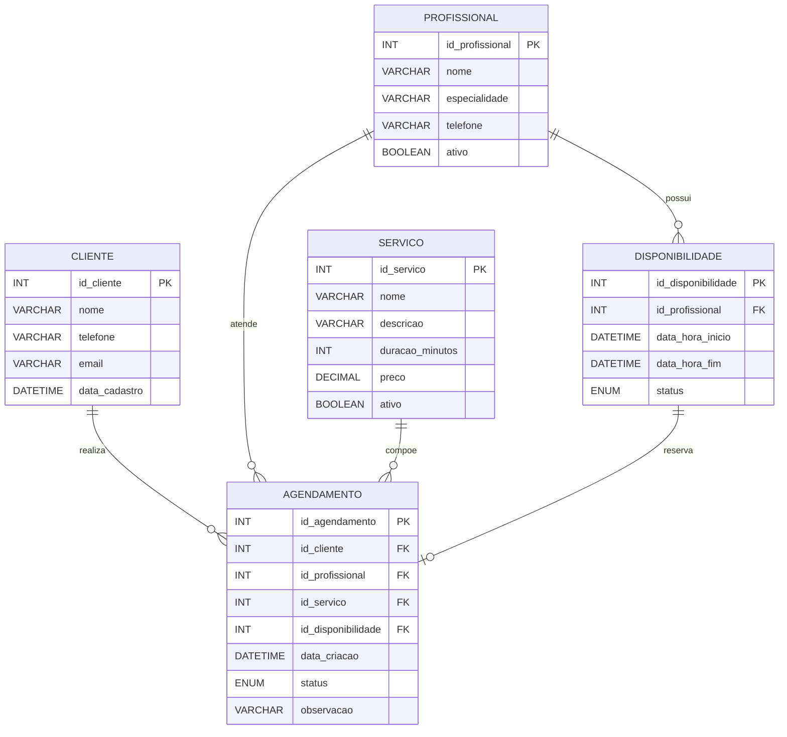

# NP Expres — Modelagem do banco de dados

**Etapa:** Modelagem do banco  
**Data:** 22/10/2026  
**Equipe:** Nicolas Miguel Cedran e Pietro Jaider

## 1. Objetivo do banco

O banco de dados da NP Expres deverá armazenar clientes, profissionais, serviços, horários disponíveis e agendamentos. O modelo foi pensado para evitar conflitos de horário e permitir que o estabelecimento consulte sua agenda.

## 2. Entidades principais

### CLIENTE
Armazena as pessoas que realizam agendamentos.

- `id_cliente` — chave primária;
- `nome` — nome completo;
- `telefone` — telefone para contato;
- `email` — e-mail do cliente;
- `data_cadastro` — data em que o cliente foi cadastrado.

### PROFISSIONAL
Armazena os profissionais que realizam os serviços.

- `id_profissional` — chave primária;
- `nome` — nome do profissional;
- `especialidade` — área de atuação;
- `telefone` — telefone de contato;
- `ativo` — indica se o profissional está disponível para novos agendamentos.

### SERVICO
Armazena os serviços oferecidos pelo salão ou barbearia.

- `id_servico` — chave primária;
- `nome` — nome do serviço;
- `descricao` — explicação do serviço;
- `duracao_minutos` — duração prevista;
- `preco` — preço do serviço;
- `ativo` — indica se o serviço está disponível.

### DISPONIBILIDADE
Armazena os horários que cada profissional disponibiliza para atendimento.

- `id_disponibilidade` — chave primária;
- `id_profissional` — chave estrangeira para `PROFISSIONAL`;
- `data_hora_inicio` — início do horário;
- `data_hora_fim` — final do horário;
- `status` — disponível, reservado ou bloqueado.

### AGENDAMENTO
Registra a reserva feita pelo cliente.

- `id_agendamento` — chave primária;
- `id_cliente` — chave estrangeira para `CLIENTE`;
- `id_profissional` — chave estrangeira para `PROFISSIONAL`;
- `id_servico` — chave estrangeira para `SERVICO`;
- `id_disponibilidade` — chave estrangeira para `DISPONIBILIDADE`;
- `data_criacao` — data de criação da reserva;
- `status` — confirmado, concluído, cancelado ou não compareceu;
- `observacao` — informação adicional do cliente.

## 3. Relacionamentos e cardinalidades

- Um **cliente** pode realizar vários agendamentos: `CLIENTE 1:N AGENDAMENTO`.
- Um **profissional** pode possuir vários horários: `PROFISSIONAL 1:N DISPONIBILIDADE`.
- Um **profissional** pode realizar vários agendamentos: `PROFISSIONAL 1:N AGENDAMENTO`.
- Um **serviço** pode aparecer em vários agendamentos: `SERVICO 1:N AGENDAMENTO`.
- Um horário de disponibilidade pode ser usado em, no máximo, um agendamento ativo: `DISPONIBILIDADE 1:0..1 AGENDAMENTO`.

## 4. Regras de integridade

1. Todo agendamento deve possuir um cliente, profissional, serviço e horário válidos.
2. Um horário bloqueado não pode ser agendado.
3. Um horário não pode possuir dois agendamentos ativos.
4. O profissional do agendamento deve ser o mesmo profissional vinculado ao horário escolhido.
5. Serviços e profissionais inativos não devem aparecer para novos agendamentos.
6. O preço é armazenado no serviço, mas pode ser copiado para o agendamento em uma versão futura para preservar o histórico de alterações.

## 5. DER em Mermaid



## 6. Modelo lógico resumido

```text
CLIENTE(
  id_cliente PK,
  nome,
  telefone,
  email,
  data_cadastro
)

PROFISSIONAL(
  id_profissional PK,
  nome,
  especialidade,
  telefone,
  ativo
)

SERVICO(
  id_servico PK,
  nome,
  descricao,
  duracao_minutos,
  preco,
  ativo
)

DISPONIBILIDADE(
  id_disponibilidade PK,
  id_profissional FK -> PROFISSIONAL.id_profissional,
  data_hora_inicio,
  data_hora_fim,
  status
)

AGENDAMENTO(
  id_agendamento PK,
  id_cliente FK -> CLIENTE.id_cliente,
  id_profissional FK -> PROFISSIONAL.id_profissional,
  id_servico FK -> SERVICO.id_servico,
  id_disponibilidade FK -> DISPONIBILIDADE.id_disponibilidade UNIQUE,
  data_criacao,
  status,
  observacao
)
```

## 7. Justificativa

A entidade `DISPONIBILIDADE` foi separada de `AGENDAMENTO` para representar horários livres antes da reserva. Assim, o sistema consegue exibir somente os horários disponíveis e impedir que duas pessoas reservem o mesmo horário. A chave estrangeira `id_disponibilidade` com restrição `UNIQUE` reforça essa regra no banco.
